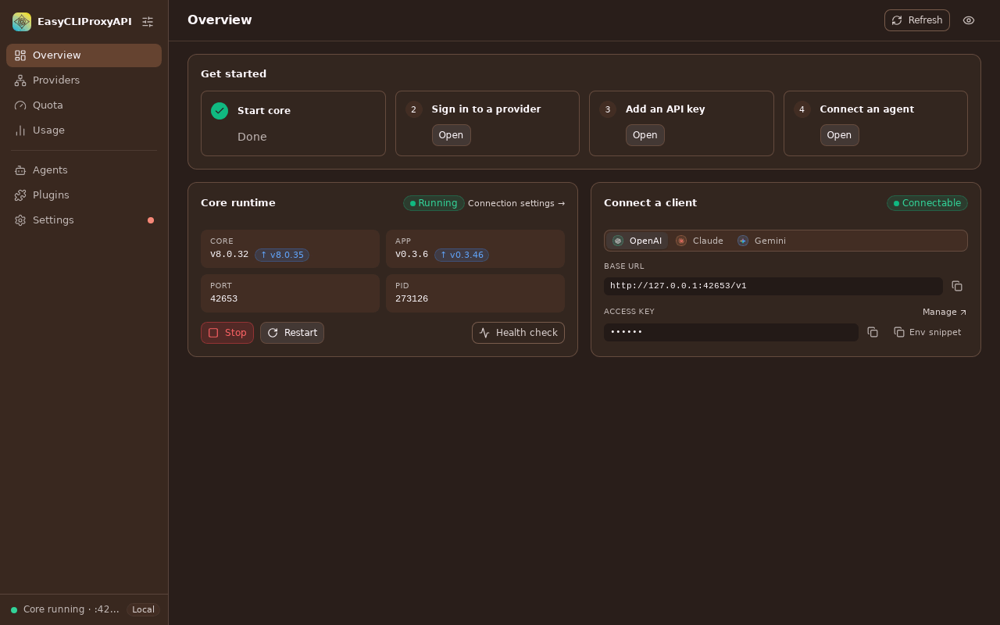
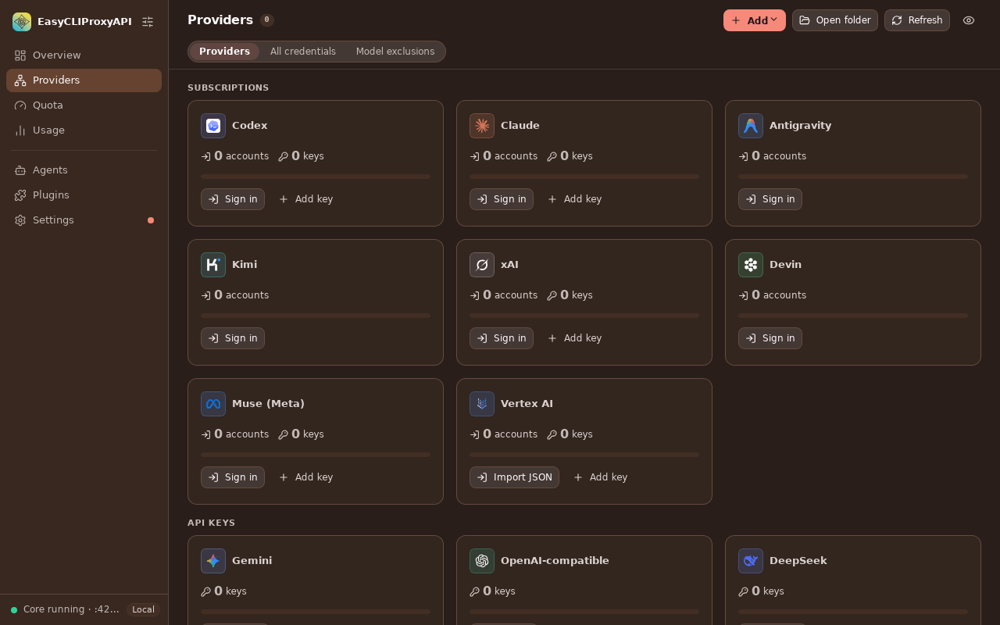
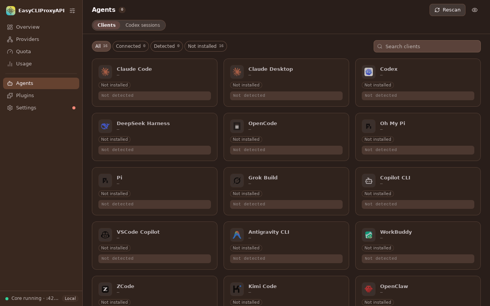
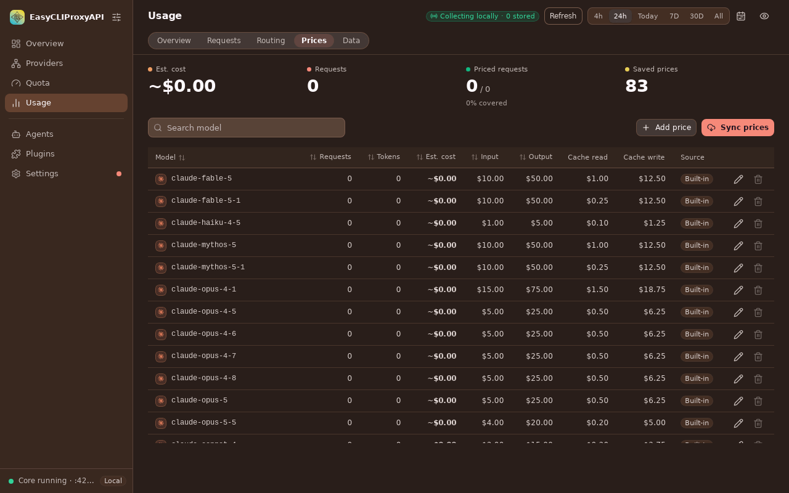
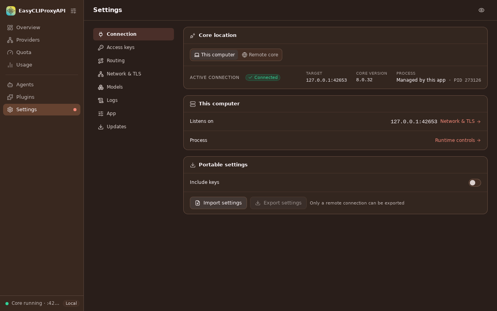
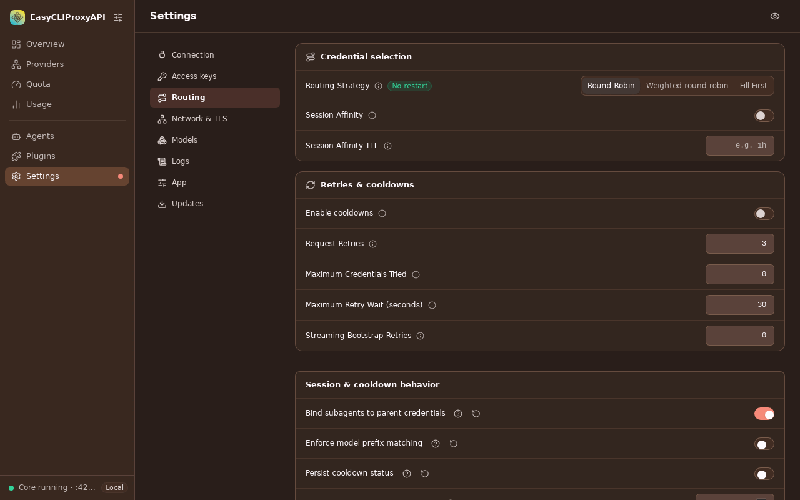

<p align="center">
  <strong>English</strong> |
  <a href="README.zh-CN.md">简体中文</a> |
  <a href="README.ja.md">日本語</a>
</p>

<p align="center">
  
</p>

<h1 align="center">EasyCLIProxyAPI</h1>

<p align="center">
  A desktop console for <a href="https://github.com/router-for-me/CLIProxyAPI">CLIProxyAPI</a>.
</p>

EasyCLIProxyAPI is a graphical desktop app for running and managing a CLIProxyAPI core: lifecycle,
OAuth sign-in, API providers, credentials, quota, usage history, plugins, and the configuration of
agent clients such as Claude Code and Codex. It is built with Tauri 2, React and Rust, and can carry
a matching core archive for first-time and offline setup.

This repository is a **fork** of [router-for-me/EasyCLIProxyAPI](https://github.com/router-for-me/EasyCLIProxyAPI),
which is the original project and the source of the app's foundation, the bundled-core packaging, the
agent integrations and the release pipeline. Please see the upstream
[README](https://github.com/router-for-me/EasyCLIProxyAPI#readme) and releases for the upstream
product. What the fork changed or removed is listed in
[docs/upstream-divergence.md](docs/upstream-divergence.md).

## What this fork adds

- **Remote core mode.** Attach to one already-running CLIProxyAPI v8 core over its management API
  instead of managing a process on this computer. See [Local vs Remote](#local-vs-remote-core) below.
- **A reworked UI with seven sections.** Overview, Providers, Quota, Usage, Agents, Plugins and
  Settings, with a route registry, a shared component kit and a global privacy mode that masks
  identifiers.
- **Quota.** Per-account quota windows with refresh, enable/disable, cooldowns, and by-provider, grid
  and timeline views. **Lighting** lets you set an opt-in schedule per credential that starts the next
  quota window after a reset or at a chosen time, with active hours and retry settings.
- **Usage history stored locally.** Traffic from the core's usage queue is kept in a local SQLite
  database, so history stays visible while the core is stopped. It includes a request list with
  detail and export, model prices, and a **Routing** view with the candidates and the policy used for
  each request.
- **An agent briefing.** `cpa-brief` prints, in about a hundred tokens, how much quota headroom each
  provider has, when its windows reset and which models are routable now, so a coding agent can decide
  how hard to fan out before it delegates. It reads cached data and never sends an inference request.
  See [docs/agent-briefing.md](docs/agent-briefing.md); `cpa-brief --skill` prints the agent skill
  ([skills/cpa-brief/SKILL.md](skills/cpa-brief/SKILL.md)) for you to install where you keep skills.
- **A browser mock and a headless observation path** so the UI can be developed and tested without
  Tauri, and the real app can be observed without a desktop session.

The upstream capabilities (multi-provider OAuth, API-provider aggregation and protocol conversion,
model aliases, authentication-file management, plugins, in-app updates, tray/menu-bar integration,
and automatic recovery of a managed local core that exits unexpectedly, see
[docs/core-recovery.md](docs/core-recovery.md)) remain.

## Local vs Remote core

| | **Local** (This computer) | **Remote** |
| --- | --- | --- |
| Core | Installed, started, supervised and updated by the app | Already running elsewhere; the app does not touch its process |
| Connection | Loopback to the managed process | Management origin and key, plus a separate client API origin and key |
| Process controls | Start, stop, restart, install, update, crash recovery | Not available |
| Agent clients | Configured against the local endpoint | Configured against the remote client API |
| Codex sessions (Agents) | Available | Hidden (they live on the local disk) |

Choose the mode in **Settings → Connection**. Use `https://` (or a private tunnel) for a remote core
on another host, since plain HTTP sends both keys unencrypted. The guide, fencing rules, transport
policy and limitations are in [docs/remote-core.md](docs/remote-core.md), which is authoritative.
Remote mode requires a v8 management API (core 8.0.29 or later).

## The sections

| Section | What it is for | Tabs |
| --- | --- | --- |
| **Overview** | Core runtime card (start/stop/restart, recovery, versions), a connect-a-client card, a provider quota summary, a usage tile, "Needs action" and "Coming up" lists, a health check, and a Get started checklist | – |
| **Providers** | OAuth sign-in and API-key providers, per-provider detail, health checks, model transfer, credential settings and model rules | Providers · All credentials · Model exclusions |
| **Quota** | Per-account quota windows, refresh, enable/disable, cooldowns, and lighting schedules | – (by provider, grid and timeline views) |
| **Usage** | Charts and statistics, requests, routing, model prices, and collector/storage controls | Overview · Requests · Routing · Prices · Data |
| **Agents** | Detect, configure, back up and launch agent clients on this computer against the selected core; Codex session browser and editor | Clients · Codex sessions (Local only) |
| **Plugins** | Core plugins: installed list, configuration and sign-in, the store, and plugin settings | Installed · Store · Settings |
| **Settings** | Core and app configuration | Connection · Access keys · Routing · Network & TLS · Models · Logs · App · Updates |

Plugins can contribute their own pages, which appear in the sidebar under Plugins. The interface is
available in English, Simplified Chinese, Traditional Chinese and Japanese, with several themes.

### Screenshots

These are renders of the real debug app (Tauri/WebKitGTK with the production frontend) in Local mode,
captured against a fresh test core with no accounts or usage, so lists are empty. How they were made
is described in [docs/screenshots](docs/screenshots/README.md).

| | |
| --- | --- |
|  |  |
| **Overview**: core runtime, connect-a-client and the Get started checklist. | **Providers**: subscription and API-key providers with sign-in and add-key actions. |
|  |  |
| **Agents**: detection and setup for agent clients. | **Usage → Prices**: model prices behind the cost estimates. |
|  |  |
| **Settings → Connection**: choose This computer or a Remote core. | **Settings → Routing**: credential selection, retries and cooldowns. |

## Quick start (release packages)

This fork does not publish release packages yet, so [build from source](#build-from-source) to try its
changes. Upstream's packages are on the
[upstream releases page](https://github.com/router-for-me/EasyCLIProxyAPI/releases/latest) and do not
include this fork's changes.

1. Extract the Windows or Linux archive, or open the macOS DMG, and launch EasyCLIProxyAPI (or run the
   portable directory from a source build).
2. For a Local core, install the bundled or latest CLIProxyAPI core from **Overview** (or **Settings →
   Updates**). For a Remote core, choose **Remote core** in **Settings → Connection**.
3. On **Overview**, start the core and follow the Get started checklist: sign in or add a provider
   under **Providers**, then connect a client from **Agents** or copy the local endpoint.

## Build from source

Prerequisites:

- [Bun](https://bun.sh) at the version in `packageManager` in `package.json` (currently 1.3.14).
- Node.js, used by the build scripts and the UI tests.
- A stable [Rust toolchain](https://rustup.rs) and the
  [Tauri 2 system prerequisites](https://v2.tauri.app/start/prerequisites/) for your platform. On
  Debian/Ubuntu the release workflow installs `libwebkit2gtk-4.1-dev libappindicator3-dev librsvg2-dev
  patchelf`.

```bash
bun install --frozen-lockfile
bun run tauri dev          # run the app with hot reload
```

Release build (Linux/macOS): `./build.sh` runs `bun tauri build --no-bundle`, then
`scripts/portable.mjs` assembles a portable directory in `bin-work/` that includes the CLIProxyAPI core
archive named by `core-version.txt` (downloaded and checksum-verified). `./run.sh` starts it.
`build.ps1` and `run.ps1` do the same on Windows. Official release packages are produced by
`.github/workflows/release.yml`. Set `CARGO_TARGET_DIR` to a directory outside the repository if you
build in several checkouts.

### Run the UI without Tauri

`bun run dev` serves the frontend with a **browser mock** of the backend (fictional data, nothing
persists). Open the printed URL, and add `?mock=running`, `?mock=stopped`, `?mock=empty` or
`?mock=error` to pick a scenario. See [src/mocks/README.md](src/mocks/README.md). In dev builds, the
shared component gallery is at `#/kit`.

## Test

```bash
bun run lint                        # Biome (existing findings are tracked separately)
bun run check                       # tsc --noEmit
bun run build                       # tsc + vite build
bun test --isolate                  # unit tests
node tests/run-ui.cjs               # the whole headless UI suite
(cd src-tauri && cargo test --bin cpa-gui)
```

- Bun tests live in `tests/unit/<area>/`; Playwright scripts live in `tests/ui/<section>/`.
  Run the **whole UI suite before merging frontend PRs**. See [tests/README.md](tests/README.md)
  for layout, filters, Playwright setup, mock contracts and manual probes.
- A green mock suite does not prove the packaged app works. To observe the real debug app headlessly,
  see [Observe the real debug app](docs/dev-observe.md).

## Architecture overview

**Frontend** (`src/`, React + TypeScript):

- `src/shell/` is the app frame. `routes.ts` is the single registry that sets the sidebar order and
  groups; add a page by adding its route.
- `src/sections/<name>/` holds one folder per section, following the convention
  `index`, `route`, `subs` (tabs), `model`, `mock`, `i18n`.
- `src/ui/` is the shared component kit (browse it at `#/kit` in a dev build).
- `src/services/platform.ts` is the only bridge to Rust (`invoke`); commands that are fenced in Remote
  mode are covered by a parity test (see [docs/remote-core.md](docs/remote-core.md)).
- `src/services/dataSource.ts` provides shared, de-duplicated data sources (core status, credentials,
  configuration, lighting, plugins).
- `src/mocks/` is the browser mock runtime used for development and by the UI tests.

**Backend** (`src-tauri/src/`, Rust), by concern: core process and runtime (`core_runtime.rs`,
`core_recovery.rs`), connection mode (`core_connection.rs`), management API client
(`management_api.rs`), `usage/` (collector and SQLite store), `agents/` and `codex_sessions/` (client
discovery and configuration), `plugins/`, `lighting.rs`, `provider_health/`, tray and window
handling, app updates, and `dev_observe.rs` (gated debug harness). Commands are registered in
`main.rs`.

## Supported platforms

GitHub Actions builds these release packages:

| Operating System | Architecture | Package |
| --- | --- | --- |
| Windows | amd64, aarch64 | ZIP |
| macOS | amd64, aarch64 | DMG |
| Linux | amd64, aarch64 | TAR.GZ |

This fork's changes have been exercised mainly on Linux; Windows and macOS behaviour that depends on
native dialogs and file permissions has not been verified for them.

## Contributing

See [CONTRIBUTING.md](CONTRIBUTING.md). Pull requests target `dev`.

## Credits and license

EasyCLIProxyAPI is created by [router-for-me](https://github.com/router-for-me); this fork builds on
[their work](https://github.com/router-for-me/EasyCLIProxyAPI). The proxy core it manages is
[CLIProxyAPI](https://github.com/router-for-me/CLIProxyAPI). Licensed under the [MIT License](LICENSE).

Other languages: [简体中文](README.zh-CN.md) · [日本語](README.ja.md) (both describe upstream and are
outdated for this fork).
